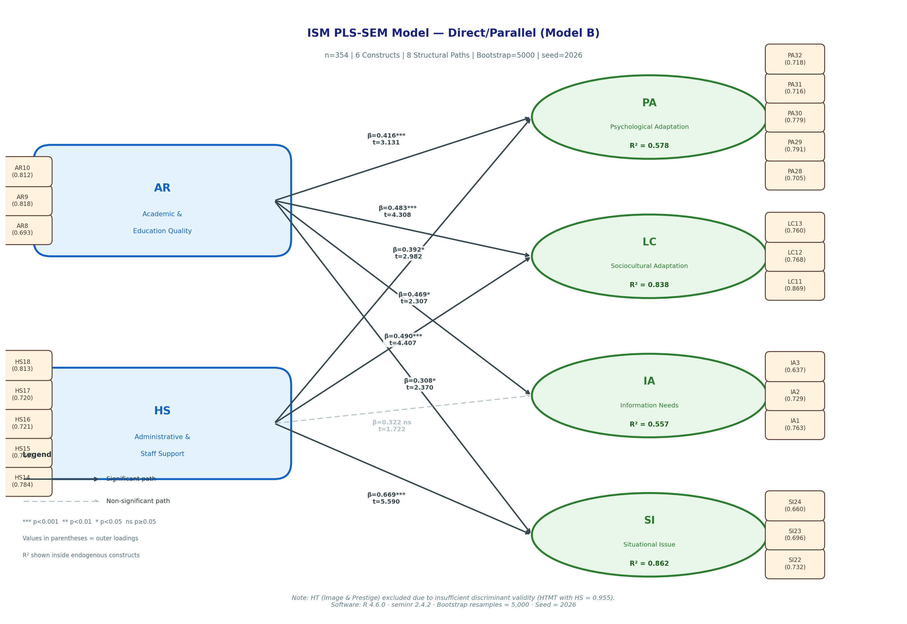

# The Information Services Management (ISM) Model for International Students in Thailand Higher Education Institutions

> **A PLS-SEM Study** | *Research Reference Repository*

[](https://www.r-project.org/)
[](https://cran.r-project.org/package=seminr)
[]()
[]()
[](https://creativecommons.org/licenses/by/4.0/)

---

## Overview

This repository contains the full research outputs — manuscript sections, PLS-SEM results, analysis scripts, and data tables — for the thesis and journal article examining how **institutional quality factors** influence **international students' adaptation and information experiences** in Thai higher education, using Partial Least Squares Structural Equation Modeling (PLS-SEM).

**Researcher:** Paiboon Manororm (667080012-5)  
**Advisor:** Assoc. Prof. Dr. Wirapong Chansanam  and Asst. Prof. Dr. Lan Thi Nguyen
**Institution:** Faculty of Informatics, Graduate School, Khon Kaen University, Thailand  
**Analysis date:** November 2026

---

## Research Context

International student enrollment in Thai higher education has reached approximately **19,000 students** across 155+ institutions, with over 75% from China (OHEC, 2015; Kang et al., 2019). Despite Thailand's strategic ambition to become an ASEAN education hub (Chang, 2011), international students frequently encounter challenges including cultural adjustment, language barriers, inadequate information services, and situational obstacles. This study develops and empirically tests an **Information Services Management (ISM) model** that integrates three theoretical dimensions:

| Dimension | Theory Basis |
|-----------|-------------|
| **Student Satisfaction** | SERVQUAL (Parasuraman et al., 1988) |
| **Cultural Adjustment** | Cross-cultural adaptation (Berry, 1997) |
| **Student Needs** | Information science (Borko, 1968; Saracevic, 2009) |

---

## ISM Model — Model B (Direct/Parallel)

The final validated model includes **6 constructs** and **8 structural paths**:

```
Exogenous (Independent)        Endogenous (Dependent)
─────────────────────────      ─────────────────────────────────────
AR — Academic & Education  ──► PA — Psychological Adaptation   (R²=0.578)
     Quality               ──► LC — Sociocultural Adaptation   (R²=0.838)
                           ──► IA — Information Needs           (R²=0.557)
                           ──► SI — Situational Issue           (R²=0.862)

HS — Administrative &      ──► PA — Psychological Adaptation
     Staff Support         ──► LC — Sociocultural Adaptation
                           - - ► IA — Information Needs  [not supported]
                           ──► SI — Situational Issue
```

> **Note:** Image and Prestige (HT) was excluded from the final model due to insufficient discriminant validity (HTMT with HS = 0.955), indicating conceptual overlap in the Thai HE context.

### Path Model Diagram



**Figure 1.** ISM PLS-SEM Direct/Parallel Model (Model B). Blue rectangles = exogenous constructs; green ovals = endogenous constructs; brown rectangles = observed indicators (loadings in parentheses). Solid arrows = significant paths (p < 0.05); dashed arrow = non-significant path. R² shown inside endogenous constructs. Bootstrap = 5,000 resamples; seed = 2026; software: R 4.6.0 · seminr 2.4.2.

---

## Sample and Data

| Parameter | Value |
|-----------|-------|
| Total respondents | 354 |
| Missing values | 0 |
| Measurement scale | Likert 1–5 |
| Items (final) | 22 (trimmed from 32) |
| Constructs | 6 (trimmed from 7) |
| University types | Autonomous, Private, Rajabhat, Technology & Occupational |
| Country | Thailand |
| Data collection | Online questionnaire (QR code / email) |

---

## Key Results

### Measurement Model

| Construct | Full Name | Items | α | ρA | ρC | AVE |
|-----------|-----------|:-----:|:---:|:---:|:---:|:---:|
| **AR** | Academic & Education Quality | AR8–AR10 | 0.816 | 0.825 | 0.819 | 0.603 |
| **HS** | Administrative & Staff Support | HS14–HS18 | 0.873 | 0.875 | 0.873 | 0.580 |
| **PA** | Psychological Adaptation | PA28–PA32 | 0.860 | 0.861 | 0.860 | 0.551 |
| **LC** | Sociocultural Adaptation | LC11–LC13 | 0.844 | 0.847 | 0.842 | 0.641 |
| **IA** | Information Needs | IA1–IA3 | 0.745 | 0.759 | 0.754 | 0.506 |
| **SI** | Situational Issue | SI22–SI24 | 0.739 | 0.740 | 0.738 | 0.485 ⚠️ |

*VIF = 1.759 for all predictors (< 5.0 threshold) ✅*

### Structural Paths — Hypothesis Testing (Bootstrap, n=5,000)

| Hyp. | Path | β | SE | t | 95% CI | p | f² | Decision |
|:----:|------|:---:|:---:|:---:|--------|:---:|:---:|:--------:|
| H1a | AR → PA | 0.416 | 0.133 | 3.131 | [0.171, 0.694] | <.001 | 0.164 | ✅ Supported |
| H1b | AR → LC | 0.483 | 0.112 | 4.308 | [0.255, 0.695] | <.001 | 0.573 | ✅ Supported |
| H1c | AR → IA | 0.469 | 0.203 | 2.307 | [0.090, 0.876] | .016  | 0.174 | ✅ Supported |
| H1d | AR → SI | 0.308 | 0.130 | 2.370 | [0.056, 0.558] | .018  | 0.273 | ✅ Supported |
| H3a | HS → PA | 0.392 | 0.131 | 2.982 | [0.122, 0.635] | .010  | 0.146 | ✅ Supported |
| H3b | HS → LC | 0.490 | 0.111 | 4.407 | [0.278, 0.710] | <.001 | 0.598 | ✅ Supported |
| H3c | HS → IA | 0.322 | 0.187 | 1.722 | [−0.052, 0.662] | .104 | 0.113 | ❌ Not Supported |
| H3d | HS → SI | **0.669** | 0.120 | **5.590** | [0.429, 0.891] | <.001 | **1.291** | ✅ **Supported** |

> **7 of 8 paths supported.** The strongest effect is **HS → SI** (β = 0.669, f² = 1.291, *very large*), indicating that Administrative and Staff Support is the most powerful institutional lever for reducing situational challenges faced by international students.

### R² Summary

| Construct | R² | Adj. R² | Interpretation |
|-----------|:---:|:-------:|----------------|
| PA | 0.578 | 0.575 | Moderate |
| LC | 0.838 | 0.838 | **Substantial** |
| IA | 0.557 | 0.554 | Moderate |
| SI | 0.862 | 0.861 | **Substantial** |

---

## Repository Structure

```
ISM-Model-International-Students-Thai-HEIS/
│
├── README.md                          ← This file
│
├── figures/
│   └── ISM_PLS_Model_Diagram.png      ← PLS-SEM path model diagram (180 DPI)
│
├── data/                              ← Analysis output tables (CSV)
│   ├── 01_data_quality.csv            ← Item-level missing & range check
│   ├── 02_descriptive_stats.csv       ← Mean and SD per item
│   ├── 03_loadings.csv                ← Outer loadings
│   ├── 04_reliability_AVE.csv         ← α, ρA, ρC, AVE per construct
│   ├── 05_HTMT.csv                    ← HTMT discriminant validity matrix
│   ├── 06_paths_R2.csv                ← Path coefficients, R², Adj. R²
│   ├── 07_VIF_structural.csv          ← VIF for each antecedent–endogenous pair
│   ├── 08_f2.csv                      ← Cohen's f² effect sizes
│   ├── 09_bootstrap_paths.csv         ← Bootstrapped paths: β, SE, t, CI, p ⭐
│   ├── 10_bootstrap_loadings.csv      ← Bootstrapped loadings: β, SE, t, CI, p
│   └── 11_bootstrap_HTMT.csv          ← Bootstrapped HTMT with CI
│
├── scripts/
│   └── ISM_PLS_ModelB_script.R        ← Full reproducible R analysis script
│
└── reports/
    └── ISM_PLS_Summary_Report.txt     ← Plain-text summary report
```

---

## How to Reproduce the Analysis

### Prerequisites

```r
install.packages(c("readxl", "dplyr", "seminr"))
```

### Run

```r
# 1. Set your data path
DATA_PATH <- "path/to/data.xlsx"   # Likert 1–5, sheet = "Factors"

# 2. Source the analysis script
source("scripts/ISM_PLS_ModelB_script.R")
```

The script will:
1. Load and validate data (354 × 22 items, 0 missing)
2. Define 6-construct reflective measurement model
3. Specify Direct/Parallel structural model (8 paths)
4. Estimate PLS model with PLSc algorithm
5. Run bootstrap inference (5,000 resamples, seed = 2026)
6. Export all result tables to CSV
7. Print final results to console

**Software:** R 4.6.0 · seminr 2.4.2 · Bootstrap = 5,000 · seed = 2026

---

## Manuscript Sections

The `article/` folder contains the full manuscript in Markdown format, ready for conversion to Word or LaTeX:

| File | Content | Tables/Figures |
|------|---------|:--------------:|
| `01_Introduction.md` | 6-paragraph introduction following PLS-SEM article writing guidelines | — |
| `02_Methods_Results.md` | Research design, sample, instrument, PLS-SEM strategy, all results | 8 tables + Figure 1 |
| `03_Discussion_Conclusion.md` | Path interpretation, comparison with prior research, limitations, contributions, future research | — |

**Convert to Word:**
```bash
pandoc article/01_Introduction.md article/02_Methods_Results.md \
       article/03_Discussion_Conclusion.md \
       -o ISM_Full_Article.docx --reference-doc=template.docx
```

---

## Theoretical Framework

```
┌─────────────────────────────────────────────────────────────────┐
│                     THEORETICAL BASIS                           │
├──────────────────┬──────────────────────┬───────────────────────┤
│   Student        │  Cultural            │  Student              │
│   Satisfaction   │  Adjustment          │  Needs                │
│   (SERVQUAL)     │  (Berry, 1997)       │  (Info. Science)      │
├──────────────────┼──────────────────────┼───────────────────────┤
│  AR — Academic   │  PA — Psychological  │  IA — Information     │
│       Quality    │       Adaptation     │       Needs           │
│  HS — Admin &    │  LC — Sociocultural  │  SI — Situational     │
│       Staff Sup. │       Adaptation     │       Issue           │
└──────────────────┴──────────────────────┴───────────────────────┘
```

---

## Key References

> Hair, J. F., Risher, J. J., Sarstedt, M., & Ringle, C. M. (2019). When to use and how to report results of PLS-SEM. *European Business Review*, *31*(1), 2–24. https://doi.org/10.1108/EBR-11-2018-0203

> Berry, J. W. (1997). Immigration, acculturation, and adaptation. *Applied Psychology*, *46*(1), 5–34.

> Parasuraman, A., Zeithaml, V. A., & Berry, L. L. (1988). SERVQUAL: A multiple-item scale for measuring consumer perceptions of service quality. *Journal of Retailing*, *64*(1), 12–40.

> Kang, C., Liu, T., & Zhan, X. (2019). International students in Thailand: Challenges and university adaptation. *Journal of International Education in Business*, *12*(2), 157–175.

> Nguyen, T. T., & Tuamsuk, K. (2022). Digitalization and information services for international students in Thailand. *Information Development*, *38*(4), 601–615.

Full reference lists are included in each manuscript section.

---

## Citation

If you use this repository, model, or analysis outputs in your research, please cite:

```
Manororm, P., Chansanam, W., & Nguyen, L.T. (2026). The Information Services Management (ISM) model
for international students in Thailand higher education institutions: A PLS-SEM study.
[Manuscript in preparation]. Faculty of Informatics, Khon Kaen University.
GitHub: https://github.com/wirapong/ISM-Model-International-Students-Thai-HEIS
```

**BibTeX:**
```bibtex
@misc{manororm2026ism,
  author    = {Manororm, Paiboon and Chansanam, Wirapong},
  title     = {The {ISM} Model for International Students in {Thailand} Higher Education Institutions: A {PLS-SEM} Study},
  year      = {2026},
  publisher = {GitHub},
  url       = {https://github.com/wirapong/ISM-Model-International-Students-Thai-HEIS},
  note      = {Manuscript in preparation}
}
```

---

## License

This work is licensed under a [Creative Commons Attribution 4.0 International License (CC BY 4.0)](https://creativecommons.org/licenses/by/4.0/).

You are free to share and adapt this material for any purpose, provided appropriate credit is given.

---

*Repository maintained by Assoc. Prof. Dr. Wirapong Chansanam, Khon Kaen University*  
*Last updated: November 2026*
